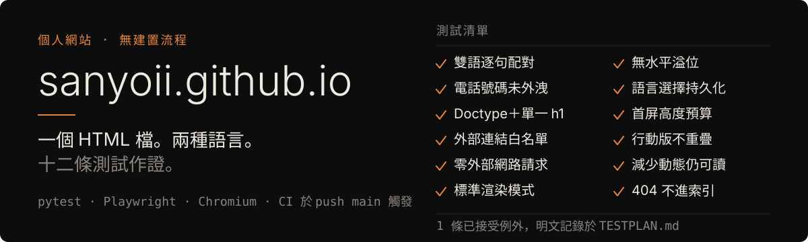
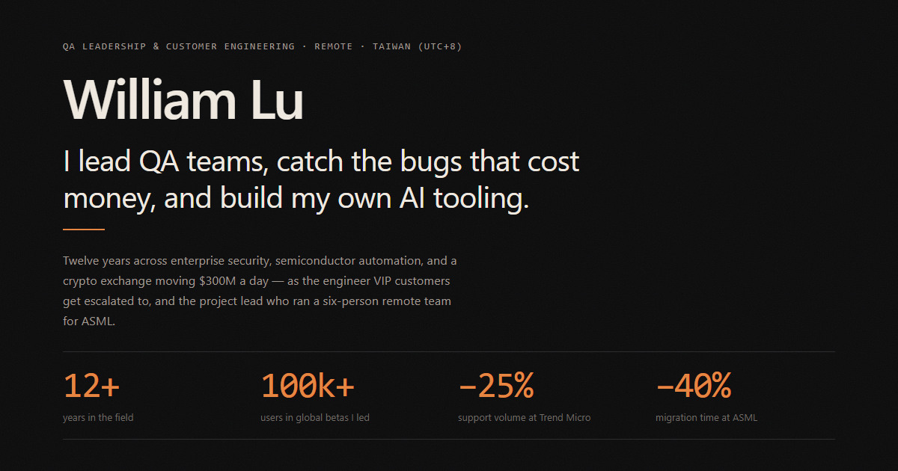

[English](README.md) | **繁體中文**

<p align="center">
  
</p>

*上圖顯示最初的 smoke-test 範圍。目前的驗證記在下文，以及所連結的執行紀錄。*

<p align="center">
  <a href="https://sanyoii.github.io/"><strong>sanyoii.github.io</strong></a> ·
  <a href="TESTPLAN.md">測試計畫</a> ·
  <a href="README.md">English</a> ·
  <a href="https://github.com/sanyoii/sanyoii.github.io/actions/workflows/pages.yml"></a>
</p>

這是 **William Lu** 的個人網站。他是資深 QA 工程師，專注於 Web3 產品品質、金融科技風險與技術支援，自台灣（UTC+8）遠端工作。

網站本身是一份手寫的 `index.html`。沒有框架、沒有建置步驟，執行時也沒有外部請求。它以雙語呈現（English／繁體中文），靠成對的 `data-en` 與 `data-zh` 屬性，而不是路由層或翻譯函式庫。

這個儲存庫會公開，是因為還有另一半。一個宣稱具有 QA 經驗的作品集，應該能夠出示自己的風險分析，所以這裡附有 [TESTPLAN.md](TESTPLAN.md)，以及靜態、執行期、響應式與產物檢查。Pages workflow 會在每次 push 到 `main` 時執行 Portfolio suite。若你是來判斷我怎麼工作，而不是只看我怎麼宣稱，請從那裡開始。

2026-09-06 修訂：依職位區分的證據路徑與 CEX Lab 連結。見[發布驗證紀錄](test-records/2026-09-06-public-release.md)；部署狀態由 Pages workflow 回報。Portfolio 測試不證明 Dashboard 已準備好發布，也不證明獨立的面試表現。首頁本身不需要建置步驟；Pages workflow 另會建置獨立的 Dashboard。

<p align="center">
  
</p>

## 這些測試實際在保護什麼

每項檢查都對應一個確實會造成影響的失敗。完整表格在 [TESTPLAN.md](TESTPLAN.md)；這裡說明背後的理由。

| 風險 | 為什麼重要 | 測試回應 |
|---|---|---|
| 其中一種語言不完整 | 訪客會看到中英夾雜的內容 | 比對成對文字與圖片 `alt` 屬性 |
| 個人聯絡資料外洩 | 隱私外洩 | 掃描兩個 HTML 檔裡的已知電話片段 |
| 文件結構無效 | 渲染不一致、語意偏弱 | 檢查 doctype、標準模式，以及只有一個 `h1` |
| 出現新的外部依賴 | 隱私、可靠性、供應鏈退步 | 將來源網址列入允許清單，並攔截瀏覽器請求 |
| 響應式內容溢位 | 導覽變得難以使用 | 在 375／768／1440 px 檢查水平溢位與首屏預算 |
| 語言狀態與 metadata 不一致 | 雙語體驗變差、搜尋摘要不準 | 切換、檢查，並在重新載入後確認狀態仍在 |
| 動態偏好把內容藏起來 | 減少動態的使用者會漏看資訊 | 模擬 reduced motion，並檢查每一個 `.fade` |
| 404 頁面可被搜尋引擎索引 | 搜尋污染與死路 | 驗證 `noindex` 與返回首頁的連結 |

## 一條例外，白紙黑字

在英文版面的 375 × 812，`.ctas` 底部略低於首屏。這項間距取捨是接受下來的，沒有藏起來，測試範圍也照實寫明：

> 這個測試刻意不宣稱，在此尺寸下英文 CTA 群組位於首屏之內。它仍要求英文與中文的 `.avail`，以及中文的 `.ctas`，留在視窗範圍內。

一套悄悄斷言不實內容的測試，比一套講明自身限制的測試更糟。

## 值得說明的決策

| 決策 | 理由 |
|---|---|
| 不用框架，也不做建置步驟 | 網站只有幾百行內容。工具鏈會多出失效方式，卻拿不掉任何一個。 |
| 執行時不發外部請求 | 沒有東西可外洩，第三方一改也不會把網站弄壞。這件事由測試強制，而不是指望審查時有人記得。 |
| 用 `data-en`／`data-zh` 做雙語 | 單一文件在結構上就會保持同步。兩份翻譯檔只要改了其中一份，就開始分岔。 |
| CI 只在 push 時執行，不排 cron | 沒有改動的作品集，不該因為無人看管的瀏覽器或 runner 更新，而一直掛著紅色徽章。 |
| 只測 Chromium | 跨瀏覽器涵蓋明確不在範圍內。計畫直接寫明，而不是暗示這套測試有它並沒有的廣度。 |

## 執行方式

網站本身不需要任何東西：

```bash
# 直接打開 index.html，或
python -m http.server
```

測試套件需要 Python 與 Chromium：

```bash
python -m pip install -r tests/requirements.txt
python -m playwright install chromium
python -m pytest tests/ -v
```

## 目錄

```text
index.html              網站
404.html                設為 noindex，並連回首頁
quality-gate/           /quality-gate/ 靜態示範
assets/                 網站使用的圖片
assets/readme/          本頁的 hero 圖（en／zh）
make_og_card.py         依 index.html 重新產生 assets/og-card.png
TESTPLAN.md             範圍、風險分析、測試清單、已接受的例外
tests/
  test_static.py        HTML 層檢查，不開瀏覽器
  test_runtime.py       透過本機 HTTP 伺服器檢查 Chromium 行為
  conftest.py           伺服器 fixture 與共用路徑
.github/workflows/      CI，只在 push 到 main 時觸發
```

## 範圍

這是個人網站，不是範本。公開是為了讓這些工作可以被查看；文字、圖片與職涯內容是我的，不打算供人再利用。
